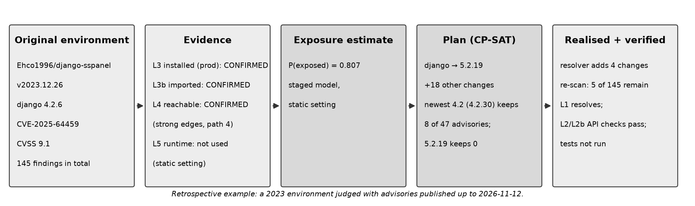

# EVIDENT — Online Supplement

All tables are generated from `data/results/` by `paper/build_supplement.py`.

## S1 Benchmark sample flow and leakage audit

| Stage | Count |
|---|---|
| triggerable advisories | 61 |
| possible apps | 976 |
| generated apps | 962 |
| skipped no safe probe | 14 |
| advisories without safe probe | 7 |
| excluded runtime errors | 0 |
| final | 962 |

| Leakage audit | Value |
|---|---|
| l5 agrees with label | 0.6507276507276507 |
| p label given l5 observed | 0.8195266272189349 |
| p label given l5 not observed | 0.4407051282051282 |
| l5 observed but not exposed | 61 |
| exposed not observed | 275 |
| note | L5 comes from a separate process running the test file; the label from the production entry point. |

## S2 Exposure probabilities — static setting

| Method | Brier | 95% CI | ECE | 95% CI | Adaptive ECE | Log-loss | AUC | 95% CI | Slope | Intercept | Calib.-in-the-large | AP | NDCG@5 |
|---|---|---|---|---|---|---|---|---|---|---|---|---|---|
| version_match | 0.426 | [0.4185172860048068, 0.4375] | 0.426 | [0.4185172860048068, 0.4375] | 0.426 | 3.925 | 0.500 | [0.5, 0.5] | n/a | n/a | 0.426 | 0.611 | 0.555 |
| coral_style | 0.188 | [0.16349611878572667, 0.1999382991881713] | 0.112 | [0.07297883064516128, 0.14717397496517182] | 0.100 | 1.075 | 0.778 | [0.7480208805967168, 0.8259658745812591] | 0.219 | -0.411 | 0.087 | 0.830 | 0.821 |
| cape_style | 0.253 | [0.22946066917620705, 0.2782326140222467] | 0.262 | [0.21712833462833472, 0.29419277231777236] | 0.262 | 1.499 | 0.739 | [0.6783234981625669, 0.8026862174766813] | 0.203 | -0.646 | 0.262 | 0.767 | 0.770 |
| naive_bayes | 0.182 | [0.1576556927578973, 0.19407485050244497] | 0.130 | [0.09664655486816662, 0.15353095977941236] | 0.135 | 0.555 | 0.766 | [0.7305388003842966, 0.8178812078966283] | 0.582 | -0.165 | 0.093 | 0.844 | 0.863 |
| logistic | 0.169 | [0.1522544481674319, 0.17699837053934592] | 0.030 | [0.02630924588297784, 0.0946091021599681] | 0.075 | 0.500 | 0.762 | [0.7288851342787256, 0.8143940356215719] | 0.926 | 0.038 | 0.001 | 0.833 | 0.816 |
| logistic_iso | 0.170 | [0.1535604088782478, 0.1773869552736853] | 0.020 | [0.014322597702979839, 0.09443962543644498] | 0.093 | 0.560 | 0.759 | [0.7280471209670013, 0.8104903060664042] | 0.420 | 0.451 | -0.001 | 0.826 | 0.798 |
| hgb_iso | 0.170 | [0.1535604088782478, 0.1773869552736853] | 0.020 | [0.014322597702979839, 0.09443962543644498] | 0.093 | 0.560 | 0.759 | [0.7280471209670013, 0.8104903060664042] | 0.420 | 0.451 | -0.001 | 0.848 | 0.922 |
| evident | 0.169 | [0.15240221999433987, 0.1770671537463447] | 0.021 | [0.02008465441765045, 0.09145305769834461] | 0.072 | 0.501 | 0.762 | [0.7288851342787256, 0.814197993445243] | 0.848 | 0.083 | 0.003 | 0.808 | 0.784 |

| Paired difference (EVIDENT − other) | ΔBrier [CI] p | ΔECE [CI] p | ΔAUC [CI] p |
|---|---|---|---|
| evident-logistic_iso | -0.001 [-0.004, 0.001] p=0.706 | -0.000 [-0.012, 0.016] p=0.988 | +0.003 [0.0, 0.009] p=0.728 |
| evident-hgb_iso | -0.001 [-0.004, 0.001] p=0.706 | -0.000 [-0.012, 0.016] p=0.988 | +0.003 [0.0, 0.009] p=0.728 |
| evident-coral_style | -0.018 [-0.026, -0.005] p=0.004 | -0.069 [-0.106, -0.014] p=0.010 | -0.014 [-0.04, 0.009] p=0.148 |
| evident-cape_style | -0.084 [-0.117, -0.063] p=0.000 | -0.215 [-0.256, -0.134] p=0.000 | +0.026 [-0.026, 0.107] p=0.516 |

## S2 Exposure probabilities — runtime setting

| Method | Brier | 95% CI | ECE | 95% CI | Adaptive ECE | Log-loss | AUC | 95% CI | Slope | Intercept | Calib.-in-the-large | AP | NDCG@5 |
|---|---|---|---|---|---|---|---|---|---|---|---|---|---|
| version_match | 0.426 | [0.417910447761194, 0.4375] | 0.426 | [0.417910447761194, 0.4375] | 0.426 | 3.925 | 0.500 | [0.5, 0.5] | n/a | n/a | 0.426 | 0.599 | 0.519 |
| coral_style | 0.188 | [0.16346788033395176, 0.20065915376651547] | 0.112 | [0.07383609974915821, 0.14581693447889515] | 0.100 | 1.075 | 0.778 | [0.7475853013077636, 0.8234001639138794] | 0.219 | -0.411 | 0.087 | 0.811 | 0.786 |
| cape_style | 0.253 | [0.23077069401876105, 0.2769018521965748] | 0.262 | [0.219560543682576, 0.29486060567269534] | 0.262 | 1.499 | 0.739 | [0.6795889316049792, 0.802032740624019] | 0.203 | -0.646 | 0.262 | 0.793 | 0.816 |
| naive_bayes | 0.136 | [0.11395493145803967, 0.14822071652052346] | 0.087 | [0.051870468434514434, 0.10771758791025031] | 0.070 | 0.397 | 0.881 | [0.8670494137922455, 0.9081814206883652] | 0.801 | -0.216 | 0.040 | 0.915 | 1.000 |
| logistic | 0.127 | [0.11184327232852728, 0.1348359227273739] | 0.056 | [0.03442088759382329, 0.08469931500329766] | 0.048 | 0.369 | 0.879 | [0.8638499816524686, 0.909739373590906] | 1.120 | -0.053 | 0.004 | 0.924 | 1.000 |
| logistic_iso | 0.128 | [0.11214365912851419, 0.1352035650548701] | 0.053 | [0.03585365917294908, 0.0755611971365233] | 0.059 | 0.388 | 0.877 | [0.8633948210128176, 0.9073779997689312] | 0.567 | 0.061 | 0.003 | 0.918 | 1.000 |
| hgb_iso | 0.127 | [0.11188474958808414, 0.13510052454182953] | 0.053 | [0.034261628181434335, 0.0755611971365233] | 0.059 | 0.387 | 0.877 | [0.8633948210128176, 0.9073779997689312] | 0.562 | 0.052 | 0.003 | 0.929 | 1.000 |
| evident | 0.127 | [0.11180532110620879, 0.13509525079992143] | 0.052 | [0.03305867873976681, 0.07694769356792956] | 0.059 | 0.368 | 0.878 | [0.8635817686701984, 0.9093202977953412] | 0.843 | -0.016 | 0.005 | 0.925 | 0.991 |

| Paired difference (EVIDENT − other) | ΔBrier [CI] p | ΔECE [CI] p | ΔAUC [CI] p |
|---|---|---|---|
| evident-logistic_iso | -0.000 [-0.001, 0.0] p=0.730 | -0.001 [-0.004, 0.002] p=0.738 | +0.001 [0.0, 0.004] p=0.738 |
| evident-hgb_iso | -0.000 [-0.0, 0.0] p=0.730 | +0.000 [-0.002, 0.002] p=0.738 | +0.001 [0.0, 0.004] p=0.738 |
| evident-coral_style | -0.060 [-0.069, -0.047] p=0.000 | -0.062 [-0.096, -0.012] p=0.022 | +0.101 [0.078, 0.129] p=0.000 |
| evident-cape_style | -0.126 [-0.156, -0.107] p=0.000 | -0.207 [-0.254, -0.151] p=0.000 | +0.142 [0.088, 0.215] p=0.000 |

## S3 Brier decomposition (static)

| Method | Reliability | Resolution | Uncertainty |
|---|---|---|---|
| coral_style | 0.018 | 0.074 | 0.245 |
| logistic_iso | 0.001 | 0.079 | 0.245 |
| hgb_iso | 0.001 | 0.079 | 0.245 |
| evident | 0.001 | 0.079 | 0.245 |

## S4 Per-pattern results (static)

| Pattern | Label rate | EVIDENT mean p | EVIDENT Brier | Logistic+iso Brier | CORAL-style Brier |
|---|---|---|---|---|---|
| E1_direct | 1.000 | 0.732 | 0.093 | 0.095 | 0.078 |
| E2_wrapper | 1.000 | 0.732 | 0.093 | 0.095 | 0.078 |
| E3_alias | 1.000 | 0.732 | 0.093 | 0.095 | 0.078 |
| E4_dict_dispatch | 1.000 | 0.732 | 0.093 | 0.095 | 0.078 |
| E5_getattr_computed | 1.000 | 0.584 | 0.181 | 0.184 | 0.234 |
| E6_class_method | 1.000 | 0.732 | 0.093 | 0.095 | 0.078 |
| E7_callback | 1.000 | 0.732 | 0.093 | 0.095 | 0.078 |
| E8_decorator_registry | 1.000 | 0.732 | 0.093 | 0.095 | 0.078 |
| E9_transitive | 1.000 | 0.732 | 0.093 | 0.095 | 0.078 |
| N1_dead_code | 0.016 | 0.474 | 0.262 | 0.260 | 0.259 |
| N2_safe_api | 0.000 | 0.553 | 0.378 | 0.377 | 0.464 |
| N3_import_only | 0.016 | 0.474 | 0.262 | 0.260 | 0.259 |
| N4_not_imported | 0.000 | 0.001 | 0.000 | 0.000 | 0.010 |
| N5_guarded_branch | 0.016 | 0.732 | 0.546 | 0.548 | 0.750 |
| N6_test_only | 0.000 | 0.001 | 0.000 | 0.000 | 0.010 |
| N7_transitive_safe | 0.000 | 0.553 | 0.378 | 0.377 | 0.464 |

## S5 Factorial ablation (evidence levels kept)

| Levels | Brier | ECE | AUC |
|---|---|---|---|
| none | 0.377 | 0.364 | 0.500 |
| L3b | 0.279 | 0.269 | 0.645 |
| L4 | 0.245 | 0.026 | 0.756 |
| L5 | 0.245 | 0.024 | 0.675 |
| L3b+L4 | 0.169 | 0.021 | 0.762 |
| L3b+L5 | 0.146 | 0.002 | 0.817 |
| L4+L5 | 0.245 | 0.026 | 0.770 |
| L3b+L4+L5 | 0.127 | 0.052 | 0.878 |

## S6 Prevalence shift (static; raw vs prior-corrected)

| Prevalence | coral_style_raw | coral_style_prior_corrected | logistic_iso_raw | logistic_iso_prior_corrected | evident_raw | evident_prior_corrected |
|---|---|---|---|---|---|---|
| 0.1 | 0.292/0.394 | 0.213/0.179 | 0.243/0.316 | 0.082/0.041 | 0.243/0.322 | 0.082/0.040 |
| 0.3 | 0.248/0.264 | 0.222/0.157 | 0.212/0.190 | 0.164/0.084 | 0.212/0.188 | 0.164/0.081 |
| 0.5 | 0.204/0.134 | 0.203/0.125 | 0.181/0.064 | 0.178/0.099 | 0.180/0.061 | 0.177/0.072 |
| 0.7 | 0.160/0.135 | 0.152/0.087 | 0.151/0.089 | 0.143/0.084 | 0.149/0.086 | 0.141/0.078 |

Cells: Brier/ECE.

## S7 Missing static evidence (ECE; Brier in parentheses)

| Mode | Rate | EVIDENT | Logistic+iso | CORAL-style | CAPE-style |
|---|---|---|---|---|---|
| independent | 0.25 | 0.022 (0.175) | 0.072 (0.193) | 0.095 (0.200) | 0.289 (0.276) |
| independent | 0.5 | 0.016 (0.182) | 0.143 (0.225) | 0.093 (0.219) | 0.317 (0.297) |
| independent | 0.75 | 0.013 (0.190) | 0.210 (0.255) | 0.087 (0.235) | 0.344 (0.320) |
| advisory | 0.25 | 0.024 (0.174) | 0.079 (0.195) | 0.103 (0.203) | 0.290 (0.275) |
| advisory | 0.5 | 0.020 (0.180) | 0.144 (0.223) | 0.096 (0.219) | 0.316 (0.296) |
| advisory | 0.75 | 0.013 (0.189) | 0.212 (0.254) | 0.085 (0.235) | 0.345 (0.320) |
| package | 0.25 | 0.029 (0.174) | 0.067 (0.191) | 0.110 (0.199) | 0.279 (0.265) |
| package | 0.5 | 0.028 (0.182) | 0.145 (0.223) | 0.097 (0.216) | 0.311 (0.292) |
| package | 0.75 | 0.018 (0.188) | 0.212 (0.251) | 0.088 (0.231) | 0.340 (0.314) |
| real-world profile | 0.291 | 0.023 (0.173) | 0.062 (0.187) | 0.097 (0.198) | 0.283 (0.272) |

## S8 Time split

| Method | Brier | ECE | AUC |
|---|---|---|---|
| version_match | 0.424 | 0.424 | 0.500 |
| coral_style | 0.184 | 0.105 | 0.789 |
| cape_style | 0.253 | 0.266 | 0.746 |
| logistic_iso | 0.163 | 0.039 | 0.804 |
| hgb_iso | 0.163 | 0.039 | 0.804 |
| evident | 0.164 | 0.045 | 0.804 |

## S9 Reachability comparison (per pattern)

| Pattern | Exposed | Apps | PyCG correct | PyCG failed | Jarvis correct | Jarvis failed | EVIDENT strong correct | EVIDENT strong+weak correct |
|---|---|---|---|---|---|---|---|---|
| E1_direct | 14 | 14 | 6 | 4 | 11 | 0 | 9 | 14 |
| E2_wrapper | 14 | 14 | 6 | 5 | 11 | 0 | 9 | 14 |
| E3_alias | 14 | 14 | 6 | 4 | 10 | 0 | 9 | 14 |
| E4_dict_dispatch | 14 | 14 | 6 | 4 | 11 | 0 | 9 | 14 |
| E5_getattr_computed | 14 | 14 | 0 | 6 | 0 | 1 | 0 | 14 |
| E6_class_method | 14 | 14 | 5 | 6 | 10 | 1 | 9 | 14 |
| E7_callback | 14 | 14 | 5 | 6 | 10 | 1 | 9 | 14 |
| E8_decorator_registry | 14 | 14 | 0 | 6 | 0 | 1 | 9 | 14 |
| E9_transitive | 14 | 14 | 6 | 4 | 11 | 0 | 9 | 14 |
| N1_dead_code | 0 | 14 | 9 | 5 | 14 | 0 | 14 | 6 |
| N2_safe_api | 0 | 13 | 8 | 5 | 13 | 0 | 13 | 5 |
| N3_import_only | 0 | 14 | 10 | 4 | 14 | 0 | 14 | 6 |
| N4_not_imported | 0 | 14 | 14 | 0 | 14 | 0 | 14 | 14 |
| N5_guarded_branch | 0 | 14 | 3 | 5 | 3 | 0 | 5 | 0 |
| N6_test_only | 0 | 14 | 14 | 0 | 14 | 0 | 14 | 14 |
| N7_transitive_safe | 0 | 13 | 8 | 5 | 13 | 0 | 13 | 5 |

```json
{
 "PyCG": {
  "analysed": 153,
  "failed": 69,
  "precision": 0.8695652173913043,
  "recall": 0.49382716049382713,
  "missed_exposed": 41,
  "exposed": 81,
  "median_seconds": 2.04
 },
 "Jarvis": {
  "analysed": 218,
  "failed": 4,
  "precision": 0.8705882352941177,
  "recall": 0.6065573770491803,
  "missed_exposed": 48,
  "exposed": 122,
  "median_seconds": 1.04
 },
 "EVIDENT strong": {
  "analysed": 222,
  "failed": 0,
  "precision": 0.8888888888888888,
  "recall": 0.5714285714285714,
  "missed_exposed": 54,
  "exposed": 126,
  "median_seconds": null
 },
 "EVIDENT strong+weak": {
  "analysed": 222,
  "failed": 0,
  "precision": 0.7325581395348837,
  "recall": 1.0,
  "missed_exposed": 0,
  "exposed": 126,
  "median_seconds": null,
  "refuted_exposed": 0
 }
}
```

## S10 Vulnerable-symbol mining validation

```json
{
 "advisories_mined": 774,
 "status": {
  "module_only": 31,
  "functions": 548,
  "no_commit": 134,
  "no_python_change": 56,
  "too_broad": 5
 },
 "functions_per_advisory": {
  "median": 2.0,
  "mean": 3.3175182481751824,
  "max": 114,
  "share_more_than_5": 0.14416058394160583
 },
 "multi_commit": {
  "advisories": 101,
  "mean_jaccard": 0.6963815352038385
 },
 "path_mapping": {
  "mapped_files": 982,
  "unmapped_files": 225,
  "rate": 0.8135874067937034,
  "unmapped_examples": [
   "aiohttp: aiohttp/compression_utils.py",
   "aiohttp: aiohttp/_cookie_helpers.py",
   "aiohttp: aiohttp/_websocket/reader_py.py",
   "aiohttp: aiohttp/_websocket/reader_py.py",
   "aiohttp: aiohttp/_websocket/reader_py.py",
   "aiohttp: aiohttp/client_middleware_digest_auth.py",
   "aiohttp: aiohttp/_websocket/reader_py.py",
   "black: action/main.py",
   "black: action/main.py",
   "brotli: scrapy/downloadermiddlewares/httpcompression.py",
   "brotli: scrapy/utils/_compression.py",
   "brotli: scrapy/utils/gz.py",
   "cryptography: src/cryptography/hazmat/backends/openssl/ciphers.py",
   "cryptography: src/cryptography/hazmat/backends/openssl/ciphers.py",
   "cryptography: vectors/cryptography_vectors/__about__.py"
  ]
 },
 "bench_triggerability": {
  "function_level": 190,
  "triggerable": 61
 }
}
```

Manual validation protocol: `data/results/symbol_annotation_sheet.csv` lists a seeded random sample of 40 function-level advisories with their fix commits and mined functions. Two annotators independently mark whether the vulnerable operation lies inside the mined functions (yes/partial/no) and list missed functions; disagreements are resolved by discussion and Cohen's kappa is reported.

## S11 Remediation details

| Strategy | ok | changed | planned_changes | unplanned_changes | unplanned_major | unplanned_added | new_findings_from_unplanned | major_bumps | findings_removed | risk_reduction_evident | risk_reduction_vm | confirmed_fixed | new_findings | api_compatible | api_broken_pkgs | objective_gap | iterations | seconds |
|---|---|---|---|---|---|---|---|---|---|---|---|---|---|---|---|---|---|---|
| audit_fix | 0.542 | 36.231 | 6.846 | 29.385 | 1.385 | 26.692 | 12.154 | 3.923 | 0.595 | 0.611 | 0.596 | 0.923 | 12.462 | 0.692 | 0.462 | n/a | n/a | 1.962 |
| latest | 0.917 | 38.818 | 10.909 | 27.909 | 2.182 | 22.955 | 6.727 | 7.773 | 0.694 | 0.710 | 0.695 | 0.932 | 11.727 | 0.455 | 0.818 | n/a | n/a | 1.336 |
| upgrade_all | 0.958 | 72.348 | n/a | n/a | n/a | n/a | n/a | 22.348 | 0.737 | 0.743 | 0.736 | 0.920 | 8.783 | 0.304 | 1.174 | n/a | n/a | 3.848 |
| uv_fix | 0.958 | 35.000 | n/a | n/a | n/a | n/a | n/a | 6.783 | 0.672 | 0.680 | 0.672 | 0.935 | 7.000 | 0.478 | 0.783 | n/a | n/a | 0.657 |
| vm_opt | 1.000 | 36.250 | 13.583 | 22.667 | 0.583 | 21.417 | 6.333 | 6.000 | 0.700 | 0.712 | 0.699 | 0.915 | 8.458 | 0.583 | 0.625 | n/a | 1.000 | 2.771 |
| coral_opt | 1.000 | 35.250 | 12.667 | 22.583 | 0.542 | 21.333 | 6.583 | 5.542 | 0.648 | 0.663 | 0.648 | 0.915 | 8.708 | 0.625 | 0.583 | n/a | 1.000 | 0.229 |
| cape_opt | 1.000 | 36.250 | 13.667 | 22.583 | 0.583 | 21.333 | 6.333 | 6.208 | 0.692 | 0.702 | 0.692 | 0.915 | 10.833 | 0.625 | 0.583 | n/a | 1.000 | 0.221 |
| evident | 1.000 | 34.000 | 11.625 | 22.375 | 0.542 | 21.125 | 6.792 | 4.917 | 0.624 | 0.660 | 0.622 | 0.906 | 7.958 | 0.625 | 0.583 | 1.762 | 1.000 | 0.288 |
| evident_wide | 1.000 | 34.000 | 11.625 | 22.375 | 0.542 | 21.125 | 6.792 | 4.917 | 0.624 | 0.660 | 0.622 | 0.906 | 7.958 | 0.625 | 0.583 | n/a | 1.000 | 0.288 |

Failure taxonomy (resolvable projects):

| Strategy | Failures |
|---|---|
| audit_fix | dependency conflict: 11, none: 13 |
| latest | dependency conflict: 1, none: 22, requires newer python: 1 |
| upgrade_all | none: 23, other: 1 |
| uv_fix | dependency conflict: 1, none: 23 |
| vm_opt | none: 24 |
| coral_opt | none: 24 |
| cape_opt | none: 24 |
| evident | none: 24 |
| evident_wide | none: 24 |

Paired Wilcoxon tests (projects where both strategies resolved):

| Comparison | n | EVIDENT median | Other median | p |
|---|---|---|---|---|
| evident_vs_vm_opt_changed | 24 | 26.500 | 29.000 | 0.001 |
| evident_vs_vm_opt_major_bumps | 24 | 5.000 | 6.000 | 0.002 |
| evident_vs_vm_opt_risk_reduction_evident | 24 | 0.615 | 0.650 | 0.001 |
| evident_vs_vm_opt_findings_removed | 24 | 0.626 | 0.714 | 0.001 |
| evident_vs_uv_fix_changed | 23 | 25.000 | 27.000 | 0.394 |
| evident_vs_uv_fix_major_bumps | 23 | 5.000 | 5.000 | 0.011 |
| evident_vs_uv_fix_risk_reduction_evident | 23 | 0.612 | 0.626 | 0.629 |
| evident_vs_uv_fix_findings_removed | 23 | 0.611 | 0.721 | 0.266 |
| evident_vs_upgrade_all_changed | 23 | 25.000 | 63.000 | 0.000 |
| evident_vs_upgrade_all_major_bumps | 23 | 5.000 | 17.000 | 0.000 |
| evident_vs_upgrade_all_risk_reduction_evident | 23 | 0.612 | 0.780 | 0.006 |
| evident_vs_upgrade_all_findings_removed | 23 | 0.611 | 0.784 | 0.002 |
| evident_vs_coral_opt_changed | 24 | 26.500 | 28.000 | 0.020 |
| evident_vs_coral_opt_major_bumps | 24 | 5.000 | 6.000 | 0.026 |
| evident_vs_coral_opt_risk_reduction_evident | 24 | 0.615 | 0.615 | 0.650 |
| evident_vs_coral_opt_findings_removed | 24 | 0.626 | 0.684 | 0.036 |

Static verdicts for findings in imported packages:

```json
{
 "l4_breakdown": {
  "states": {
   "POSSIBLE": 1306,
   "no symbol data / no source": 727,
   "reflection blocks refutation": 337,
   "CONFIRMED": 138
  },
  "reflection_where": {
   "app": 241,
   "package": 73,
   "importer": 23
  }
 },
 "app_reflection": {
  "projects": 33,
  "app_has_blocking_reflection": 21
 },
 "pareto_common": {
  "projects": 24,
  "mean_auc_gain": -0.008028213451953384,
  "median_auc_gain": 0.0007584483996720785,
  "better": 11,
  "worse": 3,
  "per_project": {
   "ActivityWatch__activitywatch@v0.12.2": -0.42211981566820267,
   "alexta69__metube@5ea5a105ecdecb7dd64e79c3be6c70971499d0f0": -0.000675536399765142,
   "allegro__ralph@20240213.1": 0.011211990914118508,
   "amisadmin__fastapi-scheduler@ec3cb6ebbe0f6a35a80c601b72a4f0fad72d62bf": 0.07257241935092304,
   "apache__superset@3.0.3": 0.0006932027108991767,
   "arrobalytics__django-ledger@v0.5.3.2": 0.01852115902407847,
   "athms__learning-from-brains@b061ef97680365a074671e0c95581af426773f9e": 0.002635030260735749,
   "autopkg__autopkg@v2.7.2": 0.0,
   "CharlyJazz__Chat-Firebase-Apache-Camel@51e03935013afc4c64269d222bb32e76479f6047": 0.00479452480488185,
   "Cog-Creators__Red-DiscordBot@3.5.2": 0.00028563097285461136,
   "Django-CRM__Django-CRM@0.10.0": 0.000316017918929809,
   "Ehco1996__django-sspanel@v2023.12.26": 0.02059682715078845,
   "Evil0ctal__Douyin_TikTok_Download_API@V3.1.6": 0.010620266353922436,
   "FoundationAgents__MetaGPT@v0.1.0": 0.020226565123457822,
   "FuzzyGrim__Yamtrack@v0.5": 0.0,
   "Gerapy__Gerapy@v0.9.13": 0.046551103369068425,
   "Gozargah__Marzban@v0.3.0": 0.011371248190870986,
   "Kav-K__GPTDiscord@v11.7.0": -0.0002810510755772988,
   "OWASP__Nettacker@0.3.1": 0.0007785246766775153,
   "PostHog__posthog@8f02ac42af212990f6303c30bd7c7cba15294183": -0.007049132941878811,
   "Rongronggg9__RSS-to-Telegram-Bot@v2.3.0": 0.0,
   "SamR1__FitTrackee@v0.7.17": 0.032332503497053744,
   "TheresAFewConors__Sooty@83fabd955970403f0fc50417e1acba4c59667453": 0.0007383721226666418,
   "WordOps__WordOps@v3.17.0": -0.01679697320338453
  }
 },
 "pareto_vs_discrimination": {
  "spearman_rho": 0.2933624129047398,
  "p": 0.16413752922000177,
  "n": 24,
  "gain_high_disc": -0.021654813114187085,
  "gain_low_disc": 0.005598386210280318
 },
 "decision": {
  "projects": 24,
  "uncertain_total": 2332,
  "critical_total": 98,
  "median_critical": 3.0
 },
 "baseline_drift": {
  "median": 7.5,
  "mean": 13.958333333333334
 }
}
```

## S12 End-to-end case study

**Project:** Ehco1996/django-sspanel @ v2023.12.26 (lockfile poetry.lock, target Python 3.11).

**Finding:** django==4.2.6, CVE-2025-64459 (CVSS 9.1, EPSS 0.193, KEV False), dependency depth 1, direct=True.

**Evidence:** L1=CONFIRMED, L2=CONFIRMED, L3=CONFIRMED, L3b=CONFIRMED, L4=CONFIRMED, L5=UNKNOWN.

**Mined symbols:** django.db.models.query_utils.Q.__init__ (granularity function).

**Witness path (strong edges):** __app__.apps.mixin.<module> → django.db.models.<module> → django.db.models.query_utils.<module> → django.db.models.query_utils.Q.__init__.

**Exposure probability:** 0.807 (class STATICALLY_REACHABLE; VEX {'state': 'exploitable'}).

**Verified plan:** django 4.2.6 → 5.2.19; plan changes 19 packages, realised environment changes 23 (4 added by the resolver), 1 solver/resolver iteration(s).

**Residual after re-scan:** 5 findings (from 145); API check: 4 used packages checked, 0 with missing symbols.

## S11b Per-application remediation outcomes

Cells: packages changed / residual findings; – = no resolvable plan.

| Application | Findings | audit_fix | latest | upgrade_all | uv_fix | vm_opt | evident |
|---|---|---|---|---|---|---|---|
| ActivityWatch/activitywatch | 8 | 6/0 | 8/0 | 24/1 | 7/1 | 6/0 | 0/8 |
| CharlyJazz/Chat-Firebase-Apache-Camel | 49 | – | 31/22 | 74/24 | 19/30 | 24/23 | 24/23 |
| Cog-Creators/Red-DiscordBot | 60 | 11/0 | 11/0 | 37/0 | 11/0 | 11/0 | 11/0 |
| Django-CRM/Django-CRM | 78 | 62/42 | 69/41 | 82/42 | 69/41 | 62/42 | 60/50 |
| Ehco1996/django-sspanel | 145 | – | 27/0 | 76/0 | 27/0 | 27/0 | 23/5 |
| Evil0ctal/Douyin_TikTok_Download_API | 93 | – | 22/3 | 38/3 | 21/23 | 22/3 | 22/3 |
| FoundationAgents/MetaGPT | 79 | – | 65/1 | 78/0 | 65/1 | 65/1 | 64/2 |
| FuzzyGrim/Yamtrack | 160 | 18/54 | 19/55 | 24/42 | 18/54 | 18/54 | 18/54 |
| Gerapy/Gerapy | 142 | – | – | 98/26 | – | 51/22 | 41/35 |
| Gozargah/Marzban | 134 | – | 31/56 | 63/52 | 26/67 | 29/55 | 28/56 |
| Kav-K/GPTDiscord | 132 | 171/130 | 164/132 | 150/61 | 136/122 | 171/130 | 170/131 |
| OWASP/Nettacker | 59 | 30/4 | 30/0 | 35/0 | 30/0 | 30/4 | 28/12 |
| PostHog/posthog | 219 | – | 68/55 | 140/42 | 60/57 | 42/62 | 41/63 |
| Rongronggg9/RSS-to-Telegram-Bot | 105 | 38/55 | 40/55 | 58/42 | 38/55 | 39/54 | 38/55 |
| SamR1/FitTrackee | 190 | – | 38/54 | 123/41 | 34/53 | 23/55 | 18/68 |
| TheresAFewConors/Sooty | 37 | – | 20/4 | – | 28/4 | 29/3 | 28/4 |
| WordOps/WordOps | 2 | 3/0 | 3/0 | 10/0 | 3/0 | 3/0 | 3/0 |
| alexta69/metube | 73 | 11/61 | 20/57 | 33/57 | 11/61 | 19/57 | 19/57 |
| allegro/ralph | 110 | 31/41 | 30/54 | 43/43 | 27/43 | 31/54 | 31/54 |
| amisadmin/fastapi-scheduler | 57 | – | 29/17 | 51/17 | 29/17 | 28/13 | 16/28 |
| apache/superset | 88 | – | 52/2 | 118/1 | 51/2 | 42/3 | 41/4 |
| arrobalytics/django-ledger | 221 | 50/54 | – | 158/0 | 51/53 | 31/78 | 25/86 |
| athms/learning-from-brains | 183 | 20/119 | 57/103 | 116/118 | 24/123 | 47/93 | 47/93 |
| autopkg/autopkg | 27 | 20/19 | 20/17 | 35/17 | 20/17 | 20/17 | 20/17 |

## S13 Fitted parameters of the staged model (static setting)

| Parameter | Value |
|---|---|
| P(D | dev-only) (heuristic) | 0.05 |
| P(M) marginal | 0.872 |
| prior P(C) | 0.657 |
| P(M | L3b=CONFIRMED) | 0.999 |
| P(M | L3b=REFUTED) | 0.008 |
| P(M | L3b=UNKNOWN) | 0.600 |
| P(C | L4=CONFIRMED) | 0.808 |
| P(C | L4=POSSIBLE) | 0.575 |
| P(C | L4=REFUTED) | 0.055 |
| P(C | L4=UNKNOWN) | 0.215 |

P(I | L3) is fixed: 1 (C), 0 (R), 0.8 (U).

## S14 Third-round analyses

Generated by `experiments/round3_bench.py`, `round3_realworld.py`, `round3_callgraph.py` and `round3_symbol_text.py` from the saved results (no new experiment runs).

### S14.1 Completed vs unprocessed real-world applications

| Group | n | Stars (median) | Locked pkgs (median, IQR) | Lockfile kinds | Frameworks |
|---|---|---|---|---|---|
| completed | 33 | 3064.0 | 56.0 [30.0, 94.0] | {'poetry': 7, 'pipfile': 3, 'requirements': 21, 'pdm': 2} | {'other': 6, 'aiohttp': 3, 'django': 13, 'fastapi': 5, 'flask': 6} |
| timeout | 3 | 1569.0 | 67.0 [64.5, 76.5] | {'requirements': 1, 'pdm': 1, 'poetry': 1} | {'flask': 1, 'fastapi': 2} |
| not_processed | 84 | 2947.5 | 63.5 [33.5, 106.75] | {'requirements': 33, 'poetry': 46, 'pipfile': 5} | {'django': 41, 'flask': 14, 'fastapi': 18, 'other': 7, 'aiohttp': 2, 'tornado': 2} |

Tests (completed vs not processed): {"stars": {"mannwhitney_p": 0.9107809618017755}, "locked": {"mannwhitney_p": 0.41003103057084145}, "lock_kind": {"chi2_p": 0.0024503585858555005, "categories": ["pdm", "pipfile", "poetry", "requirements"]}, "framework": {"chi2_p": 0.2770525977518931, "categories": ["aiohttp", "django", "fastapi", "flask", "other", "tornado"]}}

Time-outs (all occurred before findings were written, i.e. while scanning): [{"id": "alfredfrancis__ai-chatbot-framework@1a9e40805cbff0e16e124aad67656da09d3adcc7", "stars": 2168, "locked": 62, "lock_kind": "requirements", "framework": "flask", "scan_done": false}, {"id": "amisadmin__fastapi-amis-admin@v0.5.7", "stars": 1569, "locked": 67, "lock_kind": "pdm", "framework": "fastapi", "scan_done": false}, {"id": "CMHopeSunshine__LittlePaimon@v3.0.8", "stars": 1155, "locked": 86, "lock_kind": "poetry", "framework": "fastapi", "scan_done": false}]

### S14.2 Remediation eligibility

Completed 33, baseline resolvable 24 (end-to-end coverage 0.727).

| Application | Status | Reason |
|---|---|---|
| ArchiveBox__ArchiveBox@v0.7.1 | baseline_unresolvable | required package has no compatible wheel (source builds disabled) |
| CTFd__CTFd@3.5.3 | baseline_unresolvable | baseline dependency conflict (lockfile unsatisfiable for the target platform) |
| DefectDojo__django-DefectDojo@b1ad396188e813586697588b6928740f6523a99f | baseline_unresolvable | baseline dependency conflict (lockfile unsatisfiable for the target platform) |
| Flexget__Flexget@dfb206140cc33022771b1e9d5fab26855daea422 | baseline_unresolvable | baseline dependency conflict (lockfile unsatisfiable for the target platform) |
| GeoNode__geonode@4.1.0 | baseline_unresolvable | baseline dependency conflict (lockfile unsatisfiable for the target platform) |
| HaoZhang95__Python24@7cbc04568a320f0bf048f5473fa72918fda712e4 | baseline_unresolvable | required package has no compatible wheel (source builds disabled) |
| Hopetree__izone@lts | baseline_unresolvable | baseline dependency conflict (lockfile unsatisfiable for the target platform) |
| RasaHQ__rasa@3.5.11 | baseline_unresolvable | other: -aws` (v2.10.1) on the following platforms: `manylinux_2_17_aarch64`, `manylinux |
| TandoorRecipes__recipes@1.4.12 | baseline_unresolvable | required package has no compatible wheel (source builds disabled) |

### S14.3 Missing-evidence generator

```json
{
 "level_masked": "L4 only (state set to UNKNOWN with missing=True); L3b and labels untouched",
 "modes": {
  "independent": "each (application, advisory) pair masked i.i.d. with probability q",
  "advisory": "one Bernoulli(q) draw per (package, advisory); all its applications share it",
  "package": "one Bernoulli(q) draw per package; all its advisories and applications share it",
  "realworld_profile": "one draw per (package, advisory) with q = that package's share of imported real-world findings whose L4 is missing (packages with >= 3 such findings; otherwise the corpus-wide share)"
 },
 "rates": [
  0.25,
  0.5,
  0.75
 ],
 "seeds_per_setting": 5,
 "label_independent": true,
 "same_masks_for_all_models": true,
 "realworld_rate_overall": 0.28987240829346095,
 "realworld_packages_with_rate": 59,
 "training": "models are trained on unmasked rows of the other packages (leave-one-package-out); only the held-out package's rows are masked"
}
```

### S14.4 Refutation reconciliation and bounds

```json
{
 "L3b_refuted": 122,
 "L3b_refuted_exposed": 0,
 "L4_refuted_total": 144,
 "L4_refuted_exposed": 0,
 "L4_refuted_by_reason": {
  "no path even with over-approximation": 22,
  "package not imported": 122
 },
 "imported_without_strong_path": 68,
 "imported_path_refuted": 22,
 "imported_blocked_by_reflection": 46,
 "upper95_false_refutation_all": 0.02058879229949585,
 "upper95_false_refutation_path": 0.1273054316548387,
 "upper95_false_refutation_L3b": 0.02425615662029787
}
```

### S14.5 Factorisation test (static, leave-one-package-out)

| Model | Brier | 95% CI | ECE | AUC |
|---|---|---|---|---|
| staged | 0.169 | [0.153936026448062, 0.17699223018279162] | 0.021 | 0.762 |
| joint_configuration | 0.169 | [0.15381707005516396, 0.17703658651544907] | 0.014 | 0.762 |
| logistic_iso | 0.170 | [0.15552385637273713, 0.17731464810356573] | 0.020 | 0.759 |
| single_level_L4 | 0.169 | [0.15360839150535552, 0.17696270826750848] | 0.015 | 0.762 |

Staged minus joint: {"mean": -0.00012385935654724012, "ci": [-0.0004309859302853887, 0.0001432283688227287], "max_abs_prob_diff": 0.012899846801671416}

### S14.6 Calibration within evidence subgroups (static, leave-one-package-out)

| Subgroup | n | Mean P | Observed | Observed 95% CI |
|---|---|---|---|---|
| strong_reachability (L4 CONFIRMED) | 424 | 0.822 | 0.809 | [0.7682557366902376, 0.8452926829360616] |
| weak_reachability (L4 POSSIBLE) | 348 | 0.571 | 0.575 | [0.520881903431994, 0.6272610920788175] |
| reflection_blocked (L4 UNKNOWN) | 46 | 0.135 | 0.196 | [0.0935757344214087, 0.33914759951099843] |
| path_refuted (L4 REFUTED, imported) | 22 | 0.084 | 0.000 | [0.0, 0.15437251281557454] |
| not_imported (L3b REFUTED) | 122 | 0.001 | 0.000 | [0.0, 0.029784160061428703] |
| missing_symbol_info (L4 masked) | 318 | 0.572 | 0.566 | [0.5095904350505922, 0.6212433530986696] |
| development_only | 0 | n/a | n/a | not present in EVIDENT-Bench (all applications install the package for production); evaluated only through the delta sensitivity |

### S14.7 Uncertainty of leave-one-pattern-out and time split (package-grouped bootstrap)

| Validation | Model | Brier | 95% CI |
|---|---|---|---|
| leave-pattern-out | coral_style | 0.188 | [0.16564229539641942, 0.2009732079333974] |
| leave-pattern-out | logistic_iso | 0.195 | [0.17740492008537878, 0.20477068970911072] |
| leave-pattern-out | evident | 0.195 | [0.17781890540205542, 0.20492987045979197] |
| time split | coral_style | 0.184 | [0.1440406617647059, 0.20075281975255133] |
| time split | logistic_iso | 0.163 | [0.13703086951400653, 0.17239241459057073] |
| time split | evident | 0.164 | [0.13973599011826848, 0.17280367112549797] |

### S14.8 Call-graph comparison on the common subset

Common subset: 153 of 222 applications. Failure rates: {"PyCG": 0.3108108108108108, "Jarvis": 0.018018018018018018, "EVIDENT": 0.0}. Exposure rate among PyCG failures 0.652 vs 0.568 overall.

| Analysis | TP | FP | FN | TN | Precision | Recall | F1 | False-refutation rate |
|---|---|---|---|---|---|---|---|---|
| PyCG | 40 | 6 | 41 | 66 | 0.870 | 0.494 | 0.630 | 0.506 |
| Jarvis | 50 | 7 | 31 | 65 | 0.877 | 0.617 | 0.725 | 0.383 |
| EVIDENT strong | 49 | 6 | 32 | 66 | 0.891 | 0.605 | 0.721 | 0.395 |
| EVIDENT strong+weak | 81 | 32 | 0 | 40 | 0.717 | 1.000 | 0.835 | 0.000 |

### S14.9 Advisory-text cross-check of mined symbols

450 of 570 advisories with mined functions name code in their OSV text; 281 (0.624, 95% CI [0.578, 0.669]) contain a named function or class among the mined symbols. Disagreements for manual review: `data/results/symbol_text_disagreements.csv`. This is a partial, commit-independent reference and does not replace manual annotation.

### S14.10 Planned vs resolver-realised environments

| Strategy | n | Planned | Unplanned | Unplanned major | New findings (unplanned) | Residual findings | Objective gap |
|---|---|---|---|---|---|---|---|
| evident | 24 | 11.625 | 22.375 | 0.542 | 6.792 | 37.833 | 1.762 |
| vm_opt | 24 | 13.583 | 22.667 | 0.583 | 6.333 | 34.292 | - |
| coral_opt | 24 | 12.667 | 22.583 | 0.542 | 6.583 | 35.458 | - |
| uv_fix | 23 | n/a | n/a | n/a | n/a | 35.826 | - |
| latest | 22 | 10.909 | 27.909 | 2.182 | 6.727 | 33.091 | - |
| audit_fix | 13 | 6.846 | 29.385 | 1.385 | 12.154 | 44.538 | - |

EVIDENT vs untouched re-resolution drift: {"n": 24, "median_diff": 2.5, "p": 8.572377593819395e-05, "unplanned_mean": 22.375, "untouched_mean": 13.958333333333334}

Objective gap (EVIDENT only; the other optimisers plan on a different weight scale): {"definition": "realised residual expected risk (sum over remaining advisories of severity weight x exposure probability) minus the optimiser's planned residual", "mean": 1.7615808737879028, "median": 0.0, "ci_mean": [0.2752849762470311, 3.8026860081378433], "zero_gap": 16, "planned_objective_mean": 14.483010116316757}

### S14.11 Confirmed-fixed definition and denominators

share of the original findings with strong static reachability (L4 CONFIRMED) whose affected version is no longer installed in the resolver-realised environment; newly introduced findings are counted separately (new_findings); advisories are counted per (package, advisory)

| Strategy | Projects with confirmed | Confirmed findings | Fixed | Pooled | Per-project mean |
|---|---|---|---|---|---|
| evident | 18 | 89 | 83 | 0.933 | 0.875 |
| vm_opt | 18 | 89 | 84 | 0.944 | 0.886 |
| coral_opt | 18 | 89 | 84 | 0.944 | 0.886 |
| uv_fix | 17 | 86 | 84 | 0.977 | 0.912 |
| latest | 16 | 78 | 76 | 0.974 | 0.906 |
| audit_fix | 9 | 45 | 44 | 0.978 | 0.889 |
| upgrade_all | 17 | 88 | 85 | 0.966 | 0.892 |

### S14.12 Paired comparisons with effect sizes (two-sided Wilcoxon, Holm-corrected)

| Comparison | Metric | n | Median EVIDENT | Median other | Median diff | IQR diff | 95% CI median diff | Rank-biserial r | p | p (Holm) |
|---|---|---|---|---|---|---|---|---|---|---|
| evident_vs_uv_fix | changed | 23 | 25.000 | 27.000 | 0.000 | [-8.0, 1.5] | [-7.0, 0.0] | -0.255 | 0.394 | 0.532 |
| evident_vs_uv_fix | findings_removed | 23 | 0.611 | 0.721 | -0.013 | [-0.08947368421052637, 0.0] | [-0.06818181818181823, 0.0] | -0.307 | 0.266 | 0.532 |
| evident_vs_vm_opt | changed | 24 | 26.500 | 29.000 | -1.000 | [-2.5, 0.0] | [-2.0, 0.0] | -1.000 | 0.001 | 0.004 |
| evident_vs_vm_opt | findings_removed | 24 | 0.626 | 0.714 | -0.009 | [-0.044254584424862964, 0.0] | [-0.03448275862068961, 0.0] | -1.000 | 0.001 | 0.004 |
| evident_vs_coral_opt | changed | 24 | 26.500 | 28.000 | 0.000 | [-1.25, 0.0] | [-1.0, 0.0] | -0.717 | 0.020 | 0.079 |
| evident_vs_coral_opt | findings_removed | 24 | 0.626 | 0.684 | 0.000 | [-0.014787798408488095, 0.0] | [-0.012658227848101333, 0.0] | -0.617 | 0.036 | 0.107 |
| evident_vs_upgrade_all | changed | 23 | 25.000 | 63.000 | -24.000 | [-55.0, -14.0] | [-50.0, -14.0] | -0.935 | 0.000 | 0.001 |
| evident_vs_upgrade_all | findings_removed | 23 | 0.611 | 0.784 | -0.063 | [-0.13295739348370927, 0.0] | [-0.12380952380952381, -0.025316455696202556] | -0.848 | 0.002 | 0.008 |

### S14.13 Case-study figure



**Figure S1.** End-to-end case study: {"id": "Ehco1996__django-sspanel@v2023.12.26", "django_advisories_affecting_4.2.6": 47, "remaining_advisories_if_upgraded_to": {"4.2.26": 23, "4.2.30": 8, "5.2.8": 28, "5.2.19": 0}, "planned_django": "5.2.19", "planned_changes": 19, "unplanned_changes": 4, "residual_findings": 5, "original_findings": 145}

## S15 Real-world post-hoc analyses

Compatibility levels (plans):

| Strategy | Plans | L2 ok | L2b ok | No used package changed |
|---|---|---|---|---|
| audit_fix | 13 | 9 | 6 | 1 |
| latest | 22 | 10 | 8 | 2 |
| upgrade_all | 23 | 7 | 5 | 2 |
| uv_fix | 23 | 11 | 8 | 2 |
| vm_opt | 24 | 14 | 10 | 2 |
| coral_opt | 24 | 15 | 12 | 3 |
| cape_opt | 24 | 15 | 11 | 3 |
| evident | 24 | 15 | 12 | 3 |
| evident_wide | 24 | 15 | 12 | 3 |

Development-only prior δ:

| δ | Expected exposed | of which dev-only | Plan Jaccard vs default | Mean changes |
|---|---|---|---|---|
| 0.0 | 1273.205 | 0.000 | 0.998 | 11.583 |
| 0.01 | 1273.463 | 0.258 | 0.998 | 11.583 |
| 0.05 | 1274.493 | 1.288 | 1.000 | 11.625 |
| 0.1 | 1275.781 | 2.575 | 0.995 | 11.625 |
| 0.25 | 1279.644 | 6.439 | 0.995 | 11.625 |

Objective weighting:

| Variant | Projects | Mean changes | Jaccard vs default | Identical plans |
|---|---|---|---|---|
| kev1_sum | 24 | 11.625 | 1.000 | 24 |
| kev2_sum | 24 | 11.625 | 1.000 | 24 |
| kev3_sum | 24 | 11.625 | 0.997 | 23 |
| kev2_max | 24 | 9.333 | 0.746 | 6 |

Candidate limits:

| k | n | Resolves | Iterations | Seconds | Changes | Candidates |
|---|---|---|---|---|---|---|
| 6 | 24 | 1.000 | 1.000 | 2.794 | 11.625 | 55.333 |
| 8 | 24 | 1.000 | 1.000 | 0.185 | 11.625 | 55.333 |
| 12 | 24 | 1.000 | 1.000 | 0.185 | 11.625 | 55.333 |
| 20 | 24 | 1.000 | 1.000 | 0.181 | 11.625 | 55.333 |

Reflection scopes (real world):

```json
{
 "global_UNKNOWN": 352,
 "package_UNKNOWN": 352,
 "module_UNKNOWN": 344,
 "reachable_UNKNOWN": 339,
 "reachable_REFUTED": 13,
 "module_REFUTED": 8
}
```
